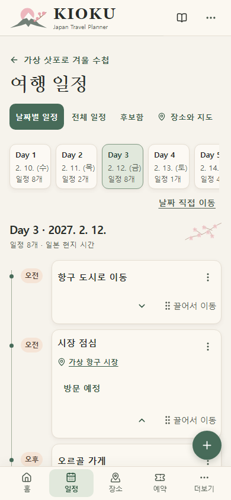

# KIOKU · 記憶

일본 여행을 계획하고, 함께 떠나고, 소중한 기억을 남기는 디지털 여행 수첩.

A travel journal for planning, exploring, and remembering Japan.

[운영 사이트](https://kioku-trip.vercel.app) · [가상 여행 예제](examples/sapporo-2027/README.md) · [v1.1 제품 검증](V1_1_PRODUCT_REVIEW.md)

v1.1 후속 작업은 기존 [Draft PR #9](https://github.com/gugonggu/KIOKU/pull/9), `feature/v1.1-product-quality`에서 이어갑니다. 종료 시각·사진 순차 업로드·표지 선택을 구현했습니다. 운영은 v1.0.0이며 DB 적용·main 병합·Production 배포는 승인 대기입니다. 다른 PC에서는 깨끗한 작업 트리를 확인하고 해당 브랜치를 `git pull --ff-only`로 갱신한 뒤 [개발 이력](DEVELOPMENT_HISTORY.md)과 [migration 순서/복구 주의](supabase/README.md)를 읽습니다.



## PLAN → TRAVEL → REMEMBER

[제품 범위와 변경 결정](docs/PRODUCT_SCOPE.md)

- 날짜별·전체 일정, 후보함, JSON 가져오기와 장소 연결
- 항공권·숙소·투어 예약과 소유자 전용 예약 가격, 여행 준비 목록
- 동행자 읽기 전용 공유, 비공개 여행 일기와 앨범, PDF 가이드
- 이메일·Google 로그인, 이 기기에 저장하는 오프라인 수첩

## 로컬 실행

Node.js 24와 npm이 필요합니다.

```powershell
npm ci
npm run dev
```

브라우저에서 [localhost:3000](http://localhost:3000)을 엽니다. Supabase 설정을 생략하면 로그인 화면에서 설정 안내를 볼 수 있습니다. 비로그인 사용자가 `/trips` 또는 `/trips/new`를 열면 `/login`으로 이동합니다.

여행 기능을 로컬에서 사용하려면 `.env.example`을 참고해 `.env.local`을 만들고, 해당 격리 Supabase 인스턴스에 [저장소 마이그레이션](supabase/README.md)을 순서대로 적용합니다. OAuth 콜백과 앱 주소는 같은 환경의 값을 사용합니다.

여행을 연 뒤 **더보기**에서 준비 목록, 오프라인 수첩, 여행 기억과 앨범, 인쇄용 여행 가이드를 관리합니다. 기능별 사용법과 격리 검증은 [여행 수첩 확장 기록](TRAVEL_SUITE.md), DB 적용 순서는 [Supabase 문서](supabase/README.md)를 참고하세요.

여행 기억과 JSON 일정 가져오기 운영 릴리스의 배포 및 스모크 기록은 [PR #6](https://github.com/gugonggu/KIOKU/pull/6)에 있습니다. 일정 파일의 [작성 규격과 예제](TRAVEL_SUITE.md#json-일정-작성-규격)와 [실기기 체크리스트](MOBILE_QA.md#실기기-체크리스트)를 참고하세요.

M13의 여행 홈, 일정 전체 보기, 모바일 지도 개선과 브라우저 비교 방법은 [디자인 검증 기록](UX_IMPROVEMENTS.md)에 있습니다. [가상 삿포로 5일 입력 예제](examples/sapporo-2027/README.md)로 가져오기와 수동 입력을 연습할 수 있습니다.

## 운영 배포와 복구

GitHub Actions에서 lint, 타입, 단위 테스트, PGlite DB, 프로덕션 빌드와 Playwright를 검증합니다. Vercel Git 연동은 PR에 Preview를 만들고 `main`을 운영에 배포합니다. Preview가 운영 DB를 사용하면 쓰기 검증은 로컬 격리 환경에서 수행합니다. 운영 배포 전 현재 정상 배포 ID를 기록하고, 배포 후 승인받은 세션 또는 읽기 전용 점검으로 로그인·보호 경로·여행 목록을 확인합니다. 앱 장애 시 직전 Ready 배포를 복원하고, DB 변경이 있는 릴리스는 [Supabase 백업과 복구 절차](supabase/README.md)를 따릅니다. [운영 사이트](https://kioku-trip.vercel.app) · [여행 수첩 UI 릴리스 PR #7](https://github.com/gugonggu/KIOKU/pull/7)

Vercel Preview는 관리형 브랜치 URL을 우선 사용합니다. 시스템 환경변수가 없는 환경에서는 유효한 명시적 `APP_URL`을 사용합니다. Preview 생성 후 보호 경로가 해당 브랜치의 로그인으로 이동하는지 확인합니다. Preview OAuth가 필요한 경우에만 Supabase에 정확한 콜백 주소를 허용합니다. 배포 개요와 알려진 제약은 [GitHub Releases](https://github.com/gugonggu/KIOKU/releases), 실기기 확인은 [모바일 검증 체크리스트](MOBILE_QA.md#실기기-체크리스트)에 기록합니다.

## 포트폴리오용 기술 요약

- 소규모 일본 여행에서 일정표, 예약 내역, 지도 링크가 여러 곳에 흩어지는 문제를 한 여행 단위로 정리했습니다. 여행 단계별 홈, 날짜별·전체 일정, 모바일 하단 내비게이션을 실제 여행 준비 흐름에 맞췄습니다. [화면 개선과 재현 방법](UX_IMPROVEMENTS.md)
- Next.js App Router와 TypeScript 앱을 Vercel Hobby에 배포하고, Supabase Free의 Auth, PostgreSQL, 비공개 Storage를 사용합니다. 소유자 데이터는 RLS로 격리합니다. 동행자 링크는 서버에서 토큰을 검증하고 허용한 필드만 반환합니다.
- MapLibre GL과 OpenFreeMap으로 저장한 장소를 표시합니다. Geoapify 설정이 없어도 장소를 직접 입력하고 좌표나 주소로 외부 길찾기를 열 수 있습니다. 오프라인 수첩은 기기별로 저장을 선택하며, 서비스 워커는 공개 정적 셸만 캐시합니다.
- 사진은 서버에서 이미지 형식과 크기를 검증하고, Sharp로 축소하면서 EXIF를 제거한 뒤 비공개 버킷에 저장합니다. PDF와 공유 화면에도 공개 범위에 맞는 데이터만 포함합니다. [저장·공유·인쇄 검증](TRAVEL_SUITE.md)
- 모바일 지도의 버튼이 핀 터치를 가로채던 문제는 컨트롤을 지도 밖으로 이동해 해결했습니다. JSON 일정 파일은 브라우저와 서버에서 같은 줄바꿈으로 비교하고, 중복 여부를 확인한 뒤 저장합니다. [가상 데이터로 화면 다시 촬영하기](UX_IMPROVEMENTS.md#재검증)

## 집과 회사 PC에서 이어서 개발하기

두 PC에서 같은 GitHub 저장소와 작업 브랜치를 사용합니다. 다른 PC로 옮기기 전에 `git status`를 확인하고, 이어서 작업할 변경은 검토한 뒤 커밋하여 프로젝트 소유자가 GitHub에 반영합니다. 새 PC에서는 저장소를 클론하거나 기존 체크아웃을 빠른 병합으로 갱신합니다(`git pull --ff-only`). Codex와 Claude Code는 PC별로 로그인하고, [공통 작업 규칙](AGENTS.md)과 Git 이력을 읽은 뒤 작업을 시작합니다.

볼트에서는 환경 파일을 `KIOKU/env/env.local`로 보관합니다. Obsidian에서 `설정 → 파일 및 링크 → 모든 파일 유형 표시`를 켜고, Google Drive Sync의 수동 전송 목록에 `KIOKU/env/env.local`이 표시되는지 확인합니다. 회사 PC에서는 같은 옵션을 켜고 사용자가 수동으로 가져옵니다. 볼트의 `README.md`와 `MANIFEST.md`도 함께 전송합니다. [Google Drive Sync 플러그인 안내](https://github.com/RichardX366/Obsidian-Google-Drive#notes)

Obsidian 볼트의 루트 경로를 현재 PowerShell 세션에 지정합니다. 다음 명령은 저장소 루트에서 실행합니다. `-VaultRoot`를 직접 넘기면 환경변수보다 우선합니다.

```powershell
$env:KIOKU_VAULT_ROOT = '<이 PC의 Obsidian 볼트 루트>'
powershell.exe -NoProfile -ExecutionPolicy Bypass -File .\scripts\sync-local-files.ps1 -Direction Import -DryRun
powershell.exe -NoProfile -ExecutionPolicy Bypass -File .\scripts\sync-local-files.ps1 -Direction Import
npm ci
npm run dev
```

Windows PowerShell 5.1에서 위 `-ExecutionPolicy Bypass`는 해당 자식 프로세스에만 적용됩니다. 회사 정책이 우선하며, 정책상 허용된 방법으로 실행합니다. 홈 PC의 확인 버전은 Node.js `24.11.1`, npm `11.6.2`입니다. `npm ci`는 저장소의 잠금 파일에 맞춰 의존성을 설치합니다.

설정을 수정한 PC에서는 같은 명령의 방향을 `Export`로 바꾸어 미리 본 후 내보냅니다. 스크립트는 저장소 루트의 `.env.local`과 볼트의 `KIOKU/env/env.local`을 비교합니다. 같은 파일은 건너뛰고, 내용이 다르면 중단합니다. 원본 방향을 확인한 뒤 `-Force`를 추가하면 기존 대상이 대상 쪽 `.kioku-local-backups` 폴더에 백업됩니다. `-DryRun -Force`로 덮어쓰기와 백업 위치를 함께 확인할 수 있습니다. 교체 백업은 각 PC에서 관리합니다.

Git에는 소스, 마이그레이션, 테스트, 비밀값 없는 `.env.example`, 복사 스크립트와 공통 규칙을 보관합니다. 실제 여행 정보가 포함될 수 있는 내부 `docs/` 및 `reference/` 원본은 기존 로컬 보관을 사용합니다. 작업을 이어 받을 때 관련 내부 요구사항이 필요하면 프로젝트 소유자에게 확인합니다.

Windows에서 `listen EACCES`로 개발 서버가 시작되지 않으면 `netsh interface ipv4 show excludedportrange protocol=tcp`로 예약된 포트를 확인합니다. 회사 PC에서 3000번이 예약되어 있으면 `npm run dev -- --port 4000`으로 실행하고 해당 PC의 `APP_URL`을 브라우저에서 여는 주소에 맞춥니다. 매직 링크를 사용하려면 Supabase **Authentication → URL Configuration → Redirect URLs**에 `http://localhost:4000/auth/confirm`을 추가합니다. 집 PC가 3000번을 사용하면 기존 Site URL과 콜백 허용 항목을 유지합니다.

회사 PC에서 로컬 포트를 바꾼 `.env.local`은 볼트로 내보내지 않습니다. 볼트에서 다시 가져오면 회사 PC의 `APP_URL`을 다시 맞춰야 합니다.

자세한 초기 운영 및 기기 검증 이력은 [개발 이력](DEVELOPMENT_HISTORY.md)에 보관합니다.

## Supabase 이메일 로그인 설정

1. `Copy-Item .env.example .env.local`로 로컬 설정 파일을 만들고 아래 값을 입력합니다.

   | 변수 | 값 |
   | --- | --- |
   | `APP_URL` | 브라우저에서 앱을 여는 주소의 오리진. 로컬 예시 `http://localhost:3000` |
   | `SUPABASE_URL` | Supabase 프로젝트 URL |
   | `SUPABASE_PUBLISHABLE_KEY` | 프로젝트의 Publishable 키(`sb_publishable_…`) |
   | `GEOAPIFY_API_KEY` | 선택 사항. 서버에서만 사용하는 일본 장소 검색 키 |
   | `KIOKU_SHARE_ENCRYPTION_KEY` | 공유 링크 발급·재확인에 필요한 서버 전용 키. 무작위 32바이트를 base64url로 인코딩한 값 |

2. Supabase **Authentication → URL Configuration**에서 Site URL을 `APP_URL`과 맞추고 Redirect URLs에 `http://localhost:3000/auth/confirm`을 추가합니다. 브라우저 주소가 다르면 `APP_URL`과 허용 목록에도 같은 오리진을 사용합니다.
3. Supabase 기본 매직 링크 템플릿은 그대로 사용할 수 있습니다. 기본 링크는 PKCE 방식이므로 요청을 시작한 브라우저에서 가장 최근 이메일의 링크를 엽니다. 신규 Free 프로젝트가 기본 SMTP를 쓰면 템플릿 수정이 제한되고 조직 팀 이메일로만 발송할 수 있습니다. 이미 커스텀 SMTP와 토큰 해시 템플릿을 쓰고 있다면 기존 `/auth/confirm`의 `token_hash`와 `type=email` 흐름도 지원합니다.

4. **Authentication → Users**에서 본인 테스트 계정을 사전에 등록하고 Email 제공자 및 SMTP 발신 설정을 확인합니다. 링크 요청에서 자동 가입을 끕니다.
5. 개발 서버를 재시작한 뒤 이메일을 제출합니다. 받은 링크를 열면 서버에서 검증하고 `/trips`로 이동합니다. 여행 메뉴에서 로그아웃한 뒤 `/trips` 재접근이 차단되는지 확인합니다.

`.env.local`에 서비스 역할 키를 넣을 필요가 없습니다. 앱은 서버에서 Supabase 토큰을 검증하고, HTTPS에서 Secure 속성을 적용한 HttpOnly 쿠키를 사용합니다. 배포 환경에서 인증 확인 경로의 쿼리 문자열과 쿠키가 프록시 또는 접근 로그에 수집되지 않도록 설정합니다. 메일 보안 프로그램이 링크를 먼저 열면 1회용 링크가 소비될 수 있습니다. 이 경우 새 링크를 요청하고, 커스텀 SMTP의 링크 추적 기능도 확인합니다.

[Supabase SSR 설정](https://supabase.com/docs/guides/auth/server-side/creating-a-client?framework=nextjs&queryGroups=framework) · [매직 링크와 이메일 템플릿](https://supabase.com/docs/guides/auth/auth-email-passwordless) · [SMTP 설정](https://supabase.com/docs/guides/auth/auth-smtp)

### Google 로그인

1. Google Cloud의 Google Auth Platform에서 OAuth 동의 화면을 설정하고 **웹 애플리케이션** OAuth Client를 만듭니다. 앱이 테스트 모드라면 Google 로그인을 사용할 기존 사용자만 테스트 사용자로 등록합니다. **Authorized JavaScript origins**에 `https://kioku-trip.vercel.app`을, **Authorized redirect URIs**에 Supabase **Authentication → Sign In / Providers → Google**에 표시되는 콜백 `https://iihimpbrrpueuqwybray.supabase.co/auth/v1/callback`을 추가합니다.
2. Supabase에서 **Allow new users to sign up**을 끈 뒤 Google Provider에 Client ID와 Client Secret을 입력하고 켭니다. Email Provider는 유지합니다. 앱은 Supabase에서 Google 활성화와 신규 가입 차단을 확인한 뒤에만 Google 로그인을 시작합니다.
3. Vercel의 Production `APP_URL`과 Supabase **Authentication → URL Configuration**의 **Site URL**을 `https://kioku-trip.vercel.app`으로 설정합니다. **Redirect URLs**에 매직 링크용 `https://kioku-trip.vercel.app/auth/confirm`과 Google용 `https://kioku-trip.vercel.app/auth/confirm?flow=google`을 추가합니다. 기존 로컬 이메일 콜백은 유지합니다. 로컬에서 Google 로그인을 쓸 경우 `http://localhost:3000/auth/confirm?flow=google` 및 `http://localhost:4000/auth/confirm?flow=google` 중 사용하는 주소를 추가합니다. Google용 Vercel 환경변수는 필요하지 않습니다.
4. 기존 계정과 **동일한 확인된 이메일**의 Google 계정으로 로그인합니다. Supabase가 같은 사용자 ID에 Google 인증을 연결하므로 여행 소유권이 유지됩니다. 이메일이 다르면 기존 이메일 링크로 먼저 접근하고 프로젝트 소유자와 별도 계정 연결을 확인합니다. 계정 데이터와 소유권을 자동으로 옮기지 않습니다.

로컬 테스트에서는 모의 Google OAuth로 기존 여행 접근, 액세스 토큰 갱신, Chrome 재시작 후 세션 유지와 로그아웃을 확인합니다. 실제 Google 계정 연결은 Provider 설정과 Redirect URL을 준비한 뒤, Google 코드가 포함된 로컬 앱 또는 배포본에서 기존 사용자 ID와 여행 접근이 유지되는지 확인합니다.

[Supabase Google 로그인](https://supabase.com/docs/guides/auth/social-sign-in/auth-google) · [Supabase 계정 연결](https://supabase.com/docs/guides/auth/auth-identity-linking)

## 검사 및 테스트

```powershell
npm run lint
npm run typecheck
npm run test:unit
npm run test:db
powershell.exe -NoProfile -ExecutionPolicy Bypass -File .\tests\sync-local-files.test.ps1
npm run build
npx playwright install chromium
npm test
```

Playwright는 위 빌드를 사용하여 기본 루프백 포트 3100~3102에서 앱과 테스트용 인증·데이터 API를 실행합니다. 테스트용 API는 실제 마이그레이션을 적용한 인메모리 PostgreSQL(PGlite)을 사용합니다. 기본 포트가 예약되어 있으면 사용 가능한 연속 포트 세 개의 시작 번호를 PowerShell에서 지정합니다. 회사 PC 예시는 4100~4102를 사용합니다.

```powershell
npm run build
$env:PLAYWRIGHT_BASE_PORT = '4100'
npm test
Remove-Item Env:PLAYWRIGHT_BASE_PORT
```

설치된 Chrome을 사용하려면 PowerShell에서 `$env:PLAYWRIGHT_CHANNEL = "chrome"`을 설정한 뒤 `npm test`를 실행합니다. 호스팅된 Supabase의 메일 수신과 PostgREST 설정은 연결 후 별도로 확인합니다.

기본 Chrome E2E는 재현 가능한 지도·검색 응답을 사용합니다. 실제 OpenFreeMap 지도까지 확인하려면 동일한 빌드에서 `$env:PLAYWRIGHT_LIVE_MAP = '1'`을 설정한 뒤 `npm test -- --grep 'M3 manually saves'`를 실행합니다. 이 시나리오는 Geoapify 키 없이 실행됩니다.

2026-11-23 회사 PC에서 대체 포트로 Playwright 20건이 통과했습니다. Supabase 대시보드에서 4000번 콜백을 등록했고, Chrome에서 실제 매직 링크로 `/trips`에 진입한 뒤 로그아웃했습니다. 로그아웃 후 `/trips`에 다시 접속하면 `/login`으로 이동하는 것을 확인했습니다.

| 명령 | 용도 |
| --- | --- |
| `npm run dev` | 개발 서버 |
| `npm run build` | 프로덕션 빌드 |
| `npm start` | 빌드 후 로컬 프로덕션 서버 |
| `npm run lint` / `npm run typecheck` | ESLint 및 TypeScript 검사 |
| `npm run test:unit` | 여행 양식 검증, 날짜와 일본 현지 상태 계산 |
| `npm run test:db` | 마이그레이션, 소유자 격리, 제약 조건과 중복 저장 방지 |
| `tests/sync-local-files.test.ps1` | 임시 체크아웃과 볼트로 설정 내보내기·복원, 미리보기, 충돌 및 백업 검사 |
| `npm test` | 브라우저에서 인증, 여행 생성·편집·삭제와 오류 복구 검증 |

## 기술 구성

Next.js 16.4.6 App Router, React 19.3.1, TypeScript 6.0.3, Tailwind CSS 4.3.5, shadcn/ui 방식의 로컬 Input, Supabase JS 2.119.2 / SSR 0.12.7, MapLibre GL JS 6.19.0, Playwright 1.65.1, PGlite 0.5.17. 버전은 `package.json`과 `package-lock.json`에 고정합니다.

`src/app`은 화면과 서버 액션, `src/components`는 공용 UI, `src/lib`는 인증과 설정을 관리합니다. `src/proxy.ts`에서 세션 쿠키를 갱신하며, 보호 페이지도 서버에서 사용자 신원을 확인합니다. 파일과 외부 요청 없이 기본 표지를 그리며, 한글은 시스템 글꼴을 사용합니다.

여행 쿼리는 현재 사용자의 소유권으로 범위를 제한하며 PostgreSQL RLS에서도 같은 경계를 적용합니다. 여행 기간은 일본 현지 날짜로 저장하고 두 날짜를 모두 비워 둘 수 있습니다. 같은 생성 폼의 재시도는 UUID로 중복 방지하고, 수정·삭제에는 현재 데이터 버전을 비교합니다.

## 개발 진행

- **UI v1.1 Phase 1** — 여행 홈은 페이드 커버, 실제 일정·장소 요약과 날짜 카드를 제공합니다. 일정은 데스크톱 날짜 탐색·타임라인·장소 요약과 모바일 가로 날짜 탐색·빠른 추가 바텀시트로 구성합니다. 저장한 장소는 기존 일정에 연결할 수 있고, 검색 결과의 장소명은 일정 이름으로 사용할 수 있습니다. 기본 커버는 생성 이미지입니다. 브라우저 검증에 쓰는 예시 여행은 로컬 테스트 데이터입니다.
- **UI v1.1 Phase 1.1 사용성** — 빠른 추가에서 저장한 장소나 검색 결과를 고르면 선택 카드와 수정 가능한 일정 이름이 표시됩니다. 검색 결과는 일정 저장 시 기존 장소 저장 RPC(`save_trip_place`)로 함께 저장·연결되며, 재시도 때 같은 결과는 중복 생성되지 않습니다. 모바일 날짜 직접 이동은 접힌 보조 UI로 줄였고, 일정 카드는 장소명·주소를 한 줄로 축약하며 모바일에서는 수정이 메뉴 안에 있습니다. 일정 화면의 새 여행·로그아웃은 `⋯` 메뉴로 옮겼고, 삿포로·홋카이도 외 여행은 벡터 기본 커버를 사용합니다. DB 스키마·RLS·인증은 변경하지 않았습니다.
- **UI v1.1 Phase 2 장소·지도** — `/trips/[tripId]/map`을 편집형 화면으로 바꿨습니다. 데스크톱은 왼쪽 장소 목록(필터·날짜 칩·이름/주소 찾기·번호 카드)과 오른쪽 큰 지도, 지도 위 선택 장소 카드로 구성합니다. 목록 번호와 지도 핀 번호가 같고 선택 상태가 서로 연동됩니다. 모바일은 목록/지도 전환과 하단 탭 위 선택 장소 시트를 사용합니다. 장소 추가·수정·삭제는 기존 서버 액션을 그대로 쓰는 대화상자(모바일 바텀시트)로 열립니다. 추가는 검색이 기본이고, 검색 실패·미설정·결과 없음이면 입력한 이름으로 직접 등록을 이어갈 수 있습니다. 주소·좌표·다국어 이름은 접힌 상세 영역에 있습니다. 하단 탭은 일정과 장소 사이에서 현재 날짜를 유지합니다. DB 스키마·RLS·인증·서버 액션은 변경하지 않았습니다.
- **Phase 2 검증 기록** — 2026-11-23 회사 PC에서 린트·타입 검사·빌드, 단위 9건, DB 12건, 헤드리스 Chrome E2E 29건 통과(`PLAYWRIGHT_BASE_PORT=4300`). 실제 지도 캡처는 `PLAYWRIGHT_LIVE_MAP=1`과 `KIOKU_UI_SCREENSHOTS`로 남깁니다.
- **Phase 2 최종 보정** — 모바일 지도 출처는 지도 위에 표시하고, 화면이 짧으면 선택 시트를 내부 스크롤로 제한합니다. 겹친 핀을 누르면 선택 시트에서 가까운 장소를 고를 수 있습니다. 저장 목록에는 좌표 없음과 지도 범위 밖을 표시합니다. 린트·타입 검사·빌드, 320·390·1440px을 포함한 Chrome 핵심 시나리오 5건, 실제 OpenFreeMap 시나리오 1건을 통과했습니다. 빌드 후 `PLAYWRIGHT_BASE_PORT=4300`으로 `npm test -- --grep 'M3 |editorial places workspace|overlapping pins'`를 재실행할 수 있습니다.
- **Phase 1.1 검증 기록** — 2026-11-23 회사 PC에서 린트·타입 검사·빌드, 단위 9건, DB 12건, 헤드리스 Chrome E2E 28건 통과. 회사 PC의 Windows 예약 포트 범위가 3001~3300으로 바뀌어 `PLAYWRIGHT_BASE_PORT=4300`을 사용했습니다. `KIOKU_UI_SCREENSHOTS`에 폴더를 지정하면 1440·390·320px 캡처를 남깁니다.
- **M2 일정 관리** — 여행 수첩의 **일정 보기**에서 `/trips/[tripId]/itinerary?date=YYYY-MM-DD`를 엽니다. 정확한 시각, 오전·오후·저녁, 시간 미정 일정을 저장하고 날짜 이동, 후보 보관·복원, 같은 그룹 내 순서 변경을 할 수 있습니다. 날짜 없는 후보는 여행 기간 판단에서 제외합니다. 기간 밖 일정은 확인 후 저장하고 별도 영역에서 표시합니다. 여행 기간을 바꾸면 표시 구역이 달라지는 일정의 날짜·개수를 먼저 보여 줍니다.
- **M2 검증 기록** — 2026-11-23 회사 PC에서 린트·타입 검사·프로덕션 빌드, 단위 6건, PGlite DB 8건, Chrome E2E 23건 통과. Chrome은 `PLAYWRIGHT_BASE_PORT=4100`과 `PLAYWRIGHT_CHANNEL=chrome`을 사용했습니다.
- **M3 장소·지도** — 여행 수첩의 **장소와 지도**에서 `/trips/[tripId]/map`을 엽니다. 장소를 수동 등록하거나 일본 내 검색 결과를 확인해 저장합니다. 지도와 목록에서 전체·날짜별·후보 장소를 볼 수 있습니다. 후보에는 날짜 없는 일정에 연결된 장소와 아직 어느 일정에도 연결되지 않은 장소가 포함됩니다. 장소를 삭제하면 연결만 해제되며 일정과 메모는 유지됩니다.
- **M3 검증 기록** — 2026-11-23 회사 PC에서 린트·타입 검사·빌드, 단위 9건, DB 12건, Chrome E2E 26건을 통과했습니다. 별도 Chrome 실행에서 실제 OpenFreeMap 스타일·타일과 핀을 확인했습니다. Geoapify는 요청·응답 단위 테스트와 브라우저 모의 응답으로 검증했습니다.
- **장소 검색과 지도 운영** — 검색은 두 글자부터 400ms 대기 후 실행하며 사용자당 분당 10회, 프로젝트 전체 UTC 기준 하루 100회까지 외부 요청을 허용합니다. 키 누락, 검색 장애, 지도 장애에도 직접 등록과 저장 목록을 쓸 수 있습니다. **내 위치**를 누를 때만 브라우저에서 위치를 한 번 조회합니다. 좌표 또는 사용 가능한 주소로 Google Maps 길찾기를 엽니다. [Geoapify 검색 API](https://apidocs.geoapify.com/docs/geocoding/address-autocomplete/) · [OpenFreeMap](https://openfreemap.org/quick_start/)
- **호스팅 M1~M3** — 2026-11-23 기존 KIOKU Supabase에 M2와 M3를 순서대로 적용했습니다. 적용 이력과 실사용 확인 내역은 [Supabase 문서](supabase/README.md)에 기록합니다.
- **M4 예약 관리** — 여행 홈 예약 요약 또는 하단 **예약**에서 `/trips/[tripId]/bookings`를 엽니다. 항공·숙소·투어별 카드에서 상태와 현지 시각을 확인하고, 유형 선택 후 편집 대화상자에서 등록합니다. 비공개 정보는 소유자 전용 상세에서 확인합니다. 일정 편집에서 같은 여행의 예약을 연결할 수 있고, 예약 삭제 시 연결을 해제하면서 일정과 시각을 보존합니다.
- **M4 로컬 검증** — 린트·타입 검사·빌드, 단위 12건, PGlite DB 14건, Chrome E2E 32건을 통과했습니다. 회사 PC Chrome은 `PLAYWRIGHT_BASE_PORT=4300`으로 실행했습니다. 빌드 후 `KIOKU_UI_SCREENSHOTS`에 폴더를 지정하고 `npm test -- --grep 'M4 creates'`를 실행하면 가상 데이터로 320·390·1440px 예약 화면을 남깁니다.
- **M5 동행자 공유** — 여행 홈의 **여행 공유**에서 공유 범위, 만료일, 링크 발급·복사·재발급·중지와 미리보기를 사용합니다. 만료는 선택한 일본 현지 날짜가 끝날 때 적용됩니다. 중지하거나 만료된 링크는 다시 활성화하지 않으며, 공유를 켤 때 새 링크를 발급합니다. 동행자는 로그인 없이 `/s/[token]`에서 날짜별 일정, 장소·지도·길찾기와 허용된 예약 요약을 확인합니다. 날짜 미정 후보는 공유 일정에서 제외합니다.
- **M5 로컬 검증** — 린트·타입 검사·빌드, 단위 13건, PGlite DB 15건, Chrome E2E 33건과 실제 OpenFreeMap 시나리오 1건을 통과했습니다. 빌드 후 `npm test -- --grep 'M5 shares'`로 재실행합니다. 캡처는 `KIOKU_UI_SCREENSHOTS`에 경로를 지정합니다.
- **사내 M5 미리보기** — 회사 PC의 로컬 실행 스크립트는 가상 데이터로 읽기 전용 여행 홈과 로그인이 필요 없는 `/companion` 진입을 제공합니다. Chrome에서 여행 홈·일정·장소·예약·공유와 모바일 지도 핀을 확인했습니다. 미리보기는 `.next/m5` 빌드를 사용합니다. 이 출력 경로를 재빌드하려면 미리보기를 중지하고 `$env:KIOKU_BUILD_DIR = '.next/m5'`로 빌드한 뒤 다시 시작합니다.
- **공유 운영** — 서버에서 `node -e "process.stdout.write(require('node:crypto').randomBytes(32).toString('base64url'))"`로 키를 생성해 비밀 저장소에 보관합니다. 같은 프로젝트에서 기존 링크를 재확인하려는 PC와 서버는 같은 키를 사용합니다. 키를 잃으면 기존 링크의 승인 여부는 검증할 수 있지만 원문을 재확인할 수 없으므로 새 키로 재발급합니다. 배포 프록시·CDN·분석에서 `/s/*` 및 `/api/shared/*` 주소, URL이 포함된 요청 헤더, 공유 검증 RPC의 본문을 기록하지 않도록 설정하고 공개 경로의 요청 빈도를 제한합니다. 링크를 중지해도 이미 내려받거나 캡처한 내용은 회수할 수 없습니다.
- **Vercel 공유 링크** — `APP_URL`이 `.vercel.app` 주소이면 공유 링크의 비밀값을 `/s#…`에 둡니다. 브라우저가 고정 경로로 읽기 요청을 보내므로 Vercel 런타임의 요청 경로에 비밀값이 들어가지 않습니다. 읽기 요청 본문과 전체 공유 주소는 분석·오류 로그에서 제외합니다. 이메일 콜백에도 검증한 환경별 `APP_URL`만 사용합니다.
- **호스팅 M4·M5** — 집 PC에서 두 마이그레이션의 적용 이력과 주요 DB 권한을 읽기 전용으로 확인했습니다. 실제 계정·PostgREST를 사용하는 예약·공유 종단 간 검증을 이어갑니다. 자세한 내용은 [Supabase 문서](supabase/README.md)를 참고하세요.
- **다른 PC에서 이어가기** — 공식 기준은 비공개 킥오프 ZIP의 `docs/01~05`입니다. 기간 밖 정책은 결정 로그 D-017을 참고하세요. `docs/`와 `reference/`는 각 PC에서 별도로 복구하고, Supabase 적용 전 [마이그레이션 이력과 권한 검사](supabase/README.md)를 확인합니다.

## 목적

개인과 소규모 그룹이 일본 여행을 준비할 때 쓰는 한국어 여행 수첩입니다.

## 범위 관리

- 화면 사진 API의 이용 조건과 요금·무료 한도는 실제 키 발급/배포 전에 최신 약관을 재검증한다.
- 운영비 0원 **목표**이지 무조건 무료 보장은 아니다. 사용량 상한·키 보호·폴백이 필수다.
- 실제 항공권/호텔 예약번호, 여행자 실명, 여권번호, 개인 이메일, 비밀 토큰은 데모·Git에 넣지 않는다.
- 현재 문서는 **제품/개발 명세**이지 기능 구현 사실 또는 외부 API 연결 완료를 뜻하지 않는다.
